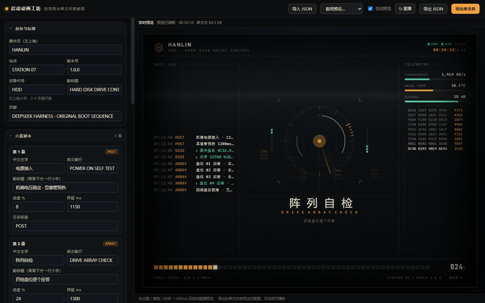
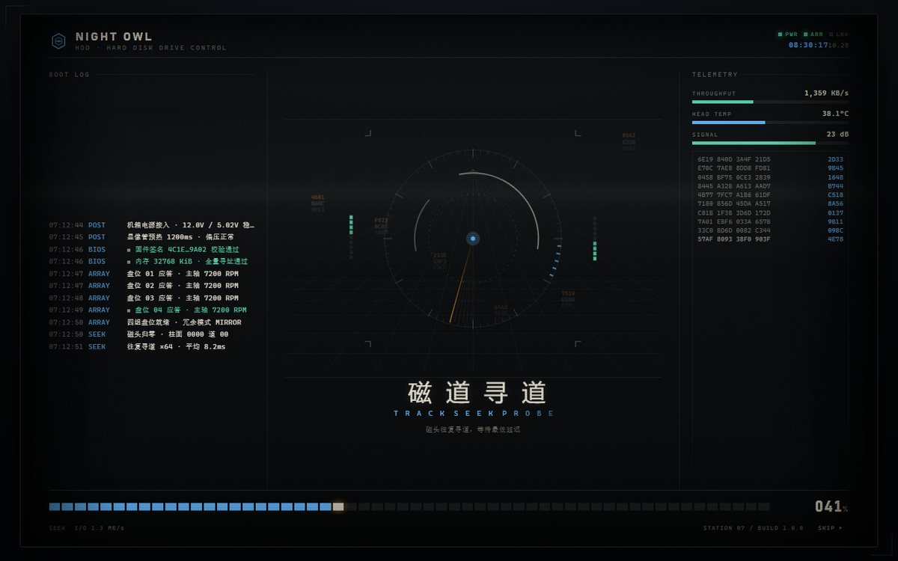
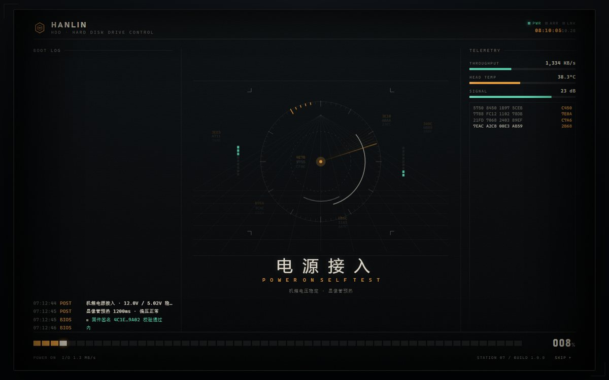
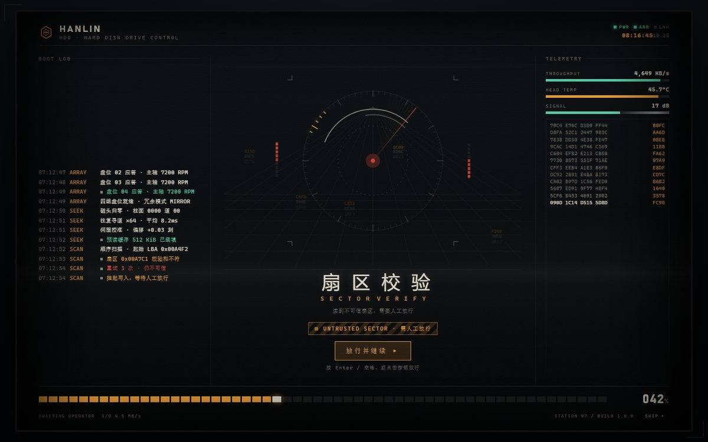
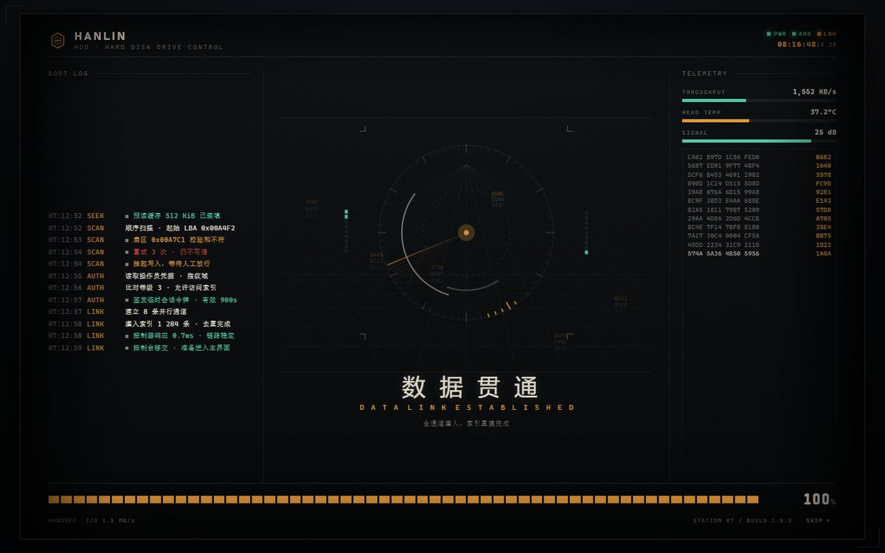
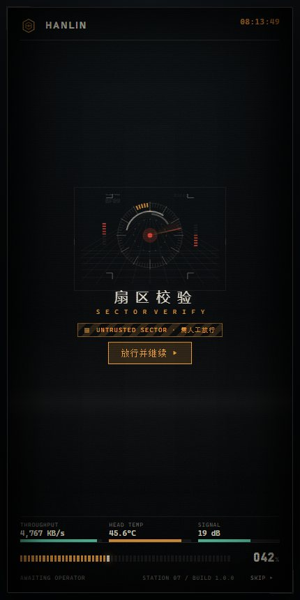

# hdd-console-boot

一台装在「深空检索终端」里的 HDD 控制台，正在冷启动。

六幕开机序列：**电源接入 → 阵列自检 → 磁道寻道 → 扇区校验（可人工放行）→ 权限核验 → 数据贯通**，最后白闪揭幕。

> **原创说明**：这是从零写的实现。视觉上借用「工业终端操作台」这一类通用语汇（CRT 扫描线、
> 等宽日志、分段进度、警示斜纹、故障切片），但**没有使用任何第三方作品的图片、音频、字体或文案**。
> 全部图形由 canvas / 手写 SVG 现场绘制，音效由 WebAudio 现场合成，文案是本项目自写的。

---

## 三种用法

| 你想做什么 | 用这个 | 说明 |
|---|---|---|
| 只想看效果 | **`demo.html`** | 双击即播，底部有重播 / 跳过 / 速度 / 颜色 / 音效控制条 |
| 装进 DSH，**在设置页里直接改** | `hdd-console-boot-1.0.0.tgz` | 设置页「开机动画」四个标签页：基础 / 六幕 / 日志 / 配色，改完保存，点「立即预览」当场看 |
| 不装 DSH，或想导出单文件送人 | **`studio.html`** | 可视化配置器，实时预览，一键导出带配置的单文件 HTML |

> 想在 DSH 里改，就**不用**打开 studio：两边改的是同一套字段（`steps` / `logs` / `colors`），
> studio 导出的 JSON 也能在设置页里「导入 JSON」直接吃进去。

---

## 在 DSH 设置页里直接改

装好插件后进 **设置 →「开机动画」**，顶部四个标签页：

| 标签 | 能改什么 |
|---|---|
| **基础** | 启用、播放时机、速度、是否要求放行、是否允许跳过、操作员 / 站点 / 设备代号 / 版本 / 副标题 / 页脚、音效与音量 |
| **六幕** | 每一幕的中文主字、英文副行、副标题、进度 %、停留时长、日志标签（共 6 张卡） |
| **日志** | 每一幕的启动日志：标签、文本、语气（普通 / 成功 / 警告 / 失败），可加行、删行，每组最多 6 行 |
| **配色** | 纸色、强调色、链路色、告警色，外加 5 套预设（默认琥珀 / 青绿 / 冰蓝 / 品红 / 旧金慢放） |

底部固定一排：**保存 / 恢复默认 / 放弃修改 / 导入 JSON / 导出 JSON / 立即预览**。

**保存后点「立即预览」就能看到新配置**——它会先重新读一次配置写进页面，再让运行时重播，
不需要刷新页面。这是和以前最大的区别（以前改完必须刷新才生效）。

第四幕的 `gate` 不开放修改（它和警示条、按钮、时间线绑定），要整段自动播就在「基础」里
关掉「要求人工放行」。

---

## 不装 DSH 也能改（studio.html）

`studio.html` 是独立配置器，不需要装任何东西，双击打开：

- **左侧**：身份标牌、**六幕的每一幕**（中文主字 / 英文副行 / 副标题 / 进度 / 停留时长 / 日志标签）、
  **每一行启动日志**（标签 / 文本 / 成功·警告·失败语气）、四组配色、声音与行为开关
- **右侧**：实时预览，改完 600ms 自动重播（也可以关掉「自动预览」手动点重播）
- **顶部**：6 套预设（默认琥珀 / 青绿 / 冰蓝 / 品红 / 极简 / 电影）、导入 JSON、导出 JSON、**导出单文件**

点「导出单文件」会下载 `my-boot-animation.html`：这个文件**自带你改的配置和全部运行时**，
双击就能播，发给别人也能用，不依赖网络、不依赖 DSH。文件右下角有一个「再播一次」按钮，
不想要可以删掉文件末尾那段 `<div id="replayBar">`。

几个能改出明显差异的点：

| 想要 | 怎么改 |
|---|---|
| 换成自己的名字 / 项目名 | 身份与标牌 → 操作员、设备代号、副标题、页脚 |
| 六幕讲自己的故事 | 六幕脚本 → 每幕的中文、英文、副标题；进度和停留决定节奏 |
| 让日志看起来像自己的系统 | 启动日志 → 改每行文本，或用「+ 加一行」补细节 |
| 换整套配色 | 配色 → 强调色（可点色板）、纸色、链路色、告警色 |
| 做得更快 / 更慢 | 声音与行为 → 速度倍率；或逐幕改「停留 ms」 |
| 不要第四幕的交互 | 声音与行为 → 关掉「第四幕要求人工放行」 |

> 第四幕固定是「等放行」的那一拍，`gate` 不开放修改——否则按钮和警示条会跟时间线失配；
> 想跳过交互就关掉上面那个总开关。

| 配置器（studio.html） | 导出的定制版（换了操作员与主色） |
|---|---|
| [](docs/screenshots/05-studio.jpg) | [](docs/screenshots/06-custom-export.jpg) |

---

## 效果预览

| 第一幕 · 电源接入 | 第四幕 · 扇区校验（等放行） |
|---|---|
| [](docs/screenshots/01-power-on.jpg) | [](docs/screenshots/02-sector-alert.jpg) |

| 第六幕 · 数据贯通 | 窄屏（430px） |
|---|---|
| [](docs/screenshots/03-data-link.jpg) | [](docs/screenshots/04-mobile.jpg) |

想直接看：**双击 `demo.html`**（单文件，CSS/JS 全内联，不需要装 DSH、不需要起服务）。
底部有一条演示控制条：重播 / 跳过 / 速度 / 强调色 / 音效，改速度与颜色是即时生效的。

---

## 六幕在讲什么

| # | 中文主字 | 英文副行 | 进度 | 这一拍发生了什么 |
|---|---|---|---|---|
| 1 | 电源接入 | `POWER ON SELF TEST` | 8% | 显像管从一条亮线展开，机箱标牌压印，阵列上电，嗡鸣起来 |
| 2 | 阵列自检 | `DRIVE ARRAY CHECK` | 24% | 四组盘位逐个应答，72 段环刻度随扫描扇区点亮 |
| 3 | 磁道寻道 | `TRACK SEEK PROBE` | 42% | 磁头往复寻道，带通噪声脉冲，遥测爬升 |
| 4 | 扇区校验 | `SECTOR VERIFY` | 58% | 读到不可信扇区：琥珀警示条 + 切片故障 + 告警双音，**停下来等你放行** |
| 5 | 权限核验 | `OPERATOR CLEARANCE` | 78% | 比对操作员凭据，三音和声钟，指示灯全绿 |
| 6 | 数据贯通 | `DATA LINK ESTABLISHED` | 100% | 八条并行通道灌入，分段进度冲满，机位后撤揭幕 |

第四幕是唯一需要动手的一拍：点「放行并继续」、按 Enter 或空格都行。不想要这一步就在设置里关掉
「要求人工放行」，整段会自动播完。右上角常驻 SKIP，Esc 也能跳。

---

## 自动更新

**默认关闭**。开启路径：设置 →「开机动画」→ 更新 → 勾选「自动检查更新」。

- 开启后，打开设置页会向 `api.github.com` 查一次仓库里的 `package.json` 版本，**24 小时最多一次**
- 发现新版本只在面板里提示「发现 vX.Y.Z，去 GitHub 下载」，**不会自动下载、不会替换插件文件**
- 面板里也有「检查更新」按钮，随时手动查一次
- 网络不可达时显示「检查失败」，不影响动画本身

为什么不做全自动：插件在运行时替换自己的文件会让 DSH 加载到半新半旧的模块，风险远大于收益。更新流程仍然是 `dsh plugin add` + 重启。

## 屏幕上有什么

- **左侧**：带时间戳的启动日志，逐字打出来，语气分四挡（普通 / 成功 / 警告 / 失败）
- **中央**：一张 canvas 仪表 —— 透视网格、72 段六边形环阵列、旋转扫描扇区、十六进制瀑布、左右立体声电平
- **右侧**：遥测（吞吐 / 磁头温度 / 信号）实时抖动，下面一列十六进制读数持续刷新
- **底部**：56 段分段进度条 + 百分比，页脚显示当前阶段、I/O 速率、机位与版本
- **全局**：CRT 扫描线、滚动亮带、噪点、暗角曲面、开机亮线、故障切片、揭幕白闪

全部动画都是「时间线驱动」，不是视频。速度可调 0.35×–3×，整段默认约 16 秒。

---

## 安装到 DSH

包名 `hdd-console-boot`。装完重启 dsh web 或桌面端，设置页会多出「开机动画」。

```bash
# 桌面端
dsh plugin --profile desktop add ./hdd-console-boot-1.0.0.tgz

# web profile
dsh plugin --profile web add ./hdd-console-boot-1.0.0.tgz
```

> 部分 DSH 版本会拒绝在终端里操作 `desktop` profile（提示 managed exclusively by the
> Electron application），此时请用桌面端的「插件」页安装，或把本目录放进 profile 的
> `node_modules` 后在 `cordis.patch.yml` 里插一条同 id 的 entry。

### 环境要求

| 项 | 要求 |
|---|---|
| 平台 | DSH **web** profile / DSH **desktop** profile |
| Node | **>= 20** |
| 依赖 | 无（不需要 `npm install`） |
| 浏览器 | 支持 canvas 2D 与 WebAudio 的现代浏览器；不支持时对应部分自动降级，动画照常播 |

### 卸载

```bash
dsh plugin --profile desktop remove hdd-console-boot
```

---

## 设置项（设置页 →「开机动画」）

### 播放

| 选项 | 默认 | 作用 |
|---|---|---|
| 启用开机动画 | 开 | 总开关 |
| 播放时机 | 每个浏览器会话一次 | `每次会话` / `每天一次` / `每次打开都播放` |
| 速度倍率 | 1× | 0.35 – 3 倍 |
| 要求人工放行 | 开 | 第四幕是否停下等按钮 / Enter / 空格 |
| 允许跳过 | 开 | 右上角 SKIP 与 Esc |

### 声音

| 选项 | 默认 | 作用 |
|---|---|---|
| 开机音效 | 开 | 嗡鸣 / 寻道噪声 / 告警双音 / 核验和声钟，全部 WebAudio 合成 |
| 音量 | 60% | 0 – 100% |

浏览器要求先有一次用户点击才准出声，所以第一幕的嗡鸣会在你第一次点页面（或按任意键）之后才起来。

### 视觉

| 选项 | 默认 | 作用 |
|---|---|---|
| 强调色 | 琥珀橙 `#f2a23c` | 也可切成青绿 `#58d6b0`；影响进度、光标、扫描扇区、警示条 |

### 身份与文案

| 选项 | 默认 | 作用 |
|---|---|---|
| 操作员 | `HANLIN` | 左上角标牌上的名字 |
| 站点 | `STATION 07` | 页脚左侧机位号 |
| 设备代号 | `HDD` | 左上角大字 |
| 版本号 | `1.0.0` | 页脚 BUILD 后面 |
| 设备副标题 | `HARD DISK DRIVE CONTROL` | 左上角小字 |
| 页脚 | `DEEPSEEK HARNESS · ORIGINAL BOOT SEQUENCE` | 底部右侧 |

配置落在 `~/.dsh/hdd-console.json`。

---

## 目录结构

```
hdd-boot/
├─ src/                 源码（唯一真相源）
│  ├─ boot.css          全部样式：CRT 机箱、屏幕、三栏布局、分段进度、揭幕
│  ├─ boot.js           运行时：六幕时间线、日志、进度、仪表接线、放行、跳过、API
│  ├─ instrument.js     中央仪表（canvas）：网格 / 环阵列 / 扫描扇区 / 十六进制瀑布 / 电平
│  ├─ audio.js          开机音（WebAudio 合成，无音频文件）
│  ├─ studio.css        配置器样式
│  ├─ studio.js         配置器逻辑（表单 / 预览 / 导出）
│  ├─ client.js         设置页面板（六幕 / 日志 / 配色，构建时注入默认值）
│  └─ replay.js         源码预览页的重播桩
├─ lib/                 插件产物（由 build.mjs 生成，勿手改）
│  ├─ index.js          Host：路由 + index.html 注入 + 配置持久化
│  ├─ client.js         设置页「开机动画」面板（由 src/client.js 生成）
│  ├─ splash.css        = src/boot.css
│  └─ splash.js         = audio.js + instrument.js + boot.js
├─ preview/index.html   源码预览页（相对路径引 src/，改完刷新即见）
├─ demo.html            单文件演示（双击即看）
├─ studio.html          可视化配置器（改完导出自己的单文件）
├─ build.mjs            构建脚本
├─ test/                冒烟测试
└─ docs/screenshots/    效果截图
```

### 改完源码记得构建

```bash
node build.mjs
```

`lib/splash.css` 与 `lib/splash.js` 是产物，Host 只下发这两个文件；`demo.html` 也会一起重生成。

### 想调什么，改哪里

| 想改 | 去这里 |
|---|---|
| 六幕文案 / 时序 / 进度 | `src/boot.js` 的 `STEPS` 与 `LOGS` |
| 日志打字速度 | `src/boot.js` 的 `logLine()` 里 `ms(8)` 与 `ms(60)` |
| 仪表的环形结构 / 十六进制瀑布密度 | `src/instrument.js` 的 `ringArray()` 与 `seedRain()` |
| 音色 / 音量 / 各音效包络 | `src/audio.js` 的 `power / seek / tick / beep / sweep / lock` |
| 配色与字体 | `src/boot.css` 顶部 `#hdd-root` 的 CSS 变量 |
| 故障切片强度 | `src/boot.css` 的 `@keyframes hdd-slice` |
| 揭幕方式 | `src/boot.css` 的 `#hdd-root.hdd-handoff` 与 `@keyframes hdd-flash` |

运行时也可以在控制台里试：

```js
HDD_API.replay()                        // 重播
HDD_API.skip()                          // 跳过
HDD_API.set({ speed: 0.6 })             // 改成 0.6 倍速（即时生效）
HDD_API.set({ accent: 'jade' })         // 换青绿
HDD_API.state                           // { finished, skipped, pct, meter }
```

---

## 测试

```bash
node test/smoke-host.mjs      # 路由 / index 注入 / 配置归一化 / 幂等
node test/smoke-splash.mjs    # 六幕脚本 / 保命机制 / 视觉系统 / 配置一致性
node test/smoke-client.mjs    # 面板形状 / slot 注册 / 字段覆盖 / 假环境执行
node test/smoke-studio.mjs    # 配置器产物：自包含 / 默认配置完整 / 解码可用
node test/smoke-panel.mjs     # 设置面板真渲染：四个标签页 / 6 张幕卡 / 12 行日志 / 4 个颜色
```

当前全绿：48 + 104 + 48 + 33 + 23 = 256 项。（另有 HTML 结构自检 16 项，见 `.tools/check-html.mjs`。）

---

## 已知边界

- **不做真正的磁盘访问**：所有「扇区」「磁头」读数都是表演性的，不读你的硬盘。
- **桌面端标题栏**：本版没有像某些启动插件那样把 Windows 标题栏整层透明化；启动画面只覆盖网页区域。
  如果你的桌面端在动画期间仍露出标题栏按钮，这是预期行为，不影响观看。
- **多显示器 / 极高 DPI**：canvas 按 `devicePixelRatio` 封顶 2 倍建面，4K 屏上细线会略软，是有意的性能取舍。

---

## 免责声明

**一、原创性。** 本项目的代码、文案、图形与时序均为独立编写。视觉风格上参考了「工业终端 / 复古 CRT
控制台」这一类通用设计语汇，但未复制任何具体作品的图像、音频、字体、界面文案或程序代码。

**二、第三方名称。** 文中出现的产品名、公司名仅用于说明兼容性与使用场景，其权利归各自所有者，
本项目与其无隶属或背书关系。

**三、仅供学习交流。** 本项目为个人学习与娱乐性质的开源插件，不用于任何商业目的。

**四、按现状提供。** 本项目不提供任何明示或暗示的担保。因使用本项目造成的任何直接或间接损失，
作者不承担责任。

---

## License

MIT

## 许可证

本项目采用**自定义许可证**，基于 Apache License 2.0 附加限制，详见 [LICENSE-CUSTOM.md](./LICENSE-CUSTOM.md)。

简单说明：

- ✅ 免费使用、修改、分发
- ✅ 为围绕本软件的服务收费（技术支持、定制、托管、培训）
- ❌ 不得把本软件本身当作收费主体（卖安装包、卖下载链接、单独计价）
- ❌ 不得在自身不是收费主体的前提下收取分发费用

Apache 2.0 全文见 [LICENSE](./LICENSE)。
